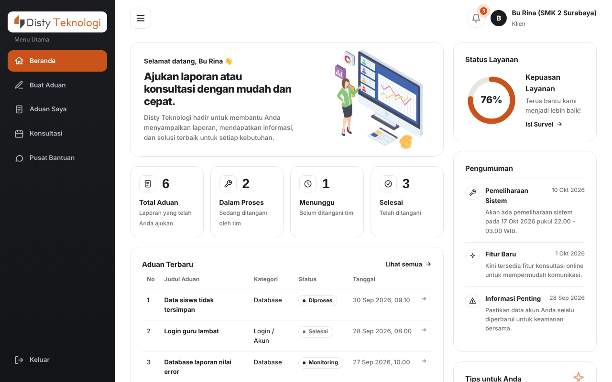

# Disty HelpDesk — Frontend

Antarmuka web layanan bantuan teknis PT Disty Teknologi Indonesia untuk tiga peran: **Klien**, **Admin**, dan **Teknisi**. Dibuat dengan HTML, CSS, JavaScript, Bootstrap, Tailwind CSS, dan React. Berupa berkas statis, tidak perlu proses build.

## Menjalankan

Tanpa backend, aplikasi memakai server tiruan (`js/mock-api.js`) sehingga semua alur bisa dicoba:

    python3 -m http.server 5500        # atau Live Server di VS Code
    # buka http://localhost:5500/login.html

Akun contoh pada mode tiruan: `rina@smkn2.sch.id` (Klien), `admin@perusahaan.id` (Admin), `rafi@perusahaan.id` (Teknisi). Kata sandi apa saja diterima pada mode tiruan.

Untuk tersambung ke backend, lihat [docs/API-INTEGRASI.md](docs/API-INTEGRASI.md). Untuk memasang di hosting, lihat [docs/DEPLOY-FRONTEND.md](docs/DEPLOY-FRONTEND.md).

## Struktur

    index.html            beranda publik (landing)
    login.html            halaman masuk dan seluruh aplikasi setelah login
    css/                  style.css (utama), dark.css (tema gelap), override.css, tailwind.css (hasil build, awalan tw-)
    js/                   data.js, utils.js, app.js, client.js, admin.js, technician.js, settings.js, i18n.js,
                          api.js (klien API), mock-api.js (server tiruan), login.js, main.js, table-fit.js
    js/components/        komponen React: StatCards, TabelAduan, Router, useCountUp, mount
    vendor/               Bootstrap dan React (berkas lokal, tanpa CDN)
    assets/               logo dan gambar
    docs/                 UI/UX, wireframe, integrasi API, pengujian, deploy

## Padanan dengan silabus Front-End Web Development

| Modul silabus | Materi | Di mana dikerjakan |
|---|---|---|
| 1. Dasar Web Development (120 jam) | HTML dan CSS dasar | `index.html`, `login.html` (struktur semantik, meta viewport, tautan berkas), `css/style.css` (variabel CSS, layout, tipografi, kartu, tabel, formulir) |
| 2. Version Control (50 jam) | Git dan GitHub | Repositori GitHub proyek ini, `.gitignore`, dan alur kerja pada bagian *Alur Git* di bawah |
| 3. JavaScript Fundamental (100 jam) | Variabel, fungsi, DOM | `js/data.js` (data dan variabel), `js/utils.js` (fungsi bantu), `js/app.js`, `js/client.js`, `js/admin.js`, `js/technician.js` (membangun dan memperbarui DOM), `js/settings.js` (`localStorage`) |
| 4. JavaScript Lanjutan (100 jam) | ES6+, event handling, async JS | Arrow function, destructuring, spread, template literal, optional chaining, dan `class ApiError` pada `js/api.js`; event `click`, `keydown`, dan `change` pada `js/utils.js` dan `js/settings.js`, serta `hashchange` dan `pagehide` pada `js/components/Router.js` dan `js/login.js`; `async/await`, `Promise.all`, `Promise.race`, dan `AbortController` pada `js/api.js` dan `js/login.js` |
| 5. Responsive Design (80 jam) | Media query, grid/flexbox, mobile-first | `css/style.css`: gaya dasar untuk ponsel lalu `@media (min-width: …)` bertahap dari 481 sampai 1101 px; grid dan flexbox; `prefers-color-scheme` dan `prefers-reduced-motion`; wireframe ponsel pada `docs/wireframe/05-ponsel.svg` |
| 6. Framework CSS (90 jam) | Bootstrap dan Tailwind | Bootstrap (`vendor/bootstrap`): `list-group`, `d-flex`, `btn` pada beranda dan Pusat Bantuan. Tailwind (`css/tailwind.css`, awalan `tw-`): `tw-grid`, `tw-grid-cols-2`, `lg:tw-grid-cols-4`, `tw-text-4xl` pada statistik beranda |
| 7. UI/UX Design (70 jam) | Wireframe, prototyping, user testing | [docs/UIUX.md](docs/UIUX.md): wireframe 5 layar, prototipe interaktif (mode tiruan), rencana dan formulir pengujian pengguna |
| 8. Front-End Framework (120 jam) | React dasar: komponen, state, props, routing | `js/components/`: komponen `KotakStat` dan `TabelAduan` dengan props, `useState` dan `useEffect`, hook buatan `useCountUp`, routing berbasis hash pada `Router.js`, dan `mount.js` (`ReactDOM.createRoot`) |
| 9. API Integration (74 jam) | Fetch API, REST API | `js/api.js`: pembungkus `fetch` (token Bearer, timeout, ulang otomatis untuk GET, galat terstruktur), objek `Api` berisi 29 pemanggil endpoint REST, `Api.muatSemua()` memuat 9 endpoint paralel; `js/mock-api.js` sebagai server tiruan |
| 10. Project Development (120 jam) | Website lengkap end-to-end | Seluruh aplikasi: tiga peran, dashboard, buat dan pantau aduan, konsultasi, survei, profil, tema gelap, dua bahasa (`js/i18n.js`), dokumen pengujian, dan simulasi deployment |

## Alur Git

    git checkout -b fitur/nama-fitur      # cabang baru per fitur
    git add . && git commit -m "Pesan commit yang jelas"
    git push -u origin fitur/nama-fitur
    # buka Pull Request di GitHub, minta tinjauan, lalu Merge ke main
    git checkout main && git pull

## Dokumen

- [docs/UIUX.md](docs/UIUX.md) — wireframe, prototipe, pengujian pengguna
- [docs/API-INTEGRASI.md](docs/API-INTEGRASI.md) — endpoint dan cara menyambung ke backend
- [docs/PENGUJIAN.md](docs/PENGUJIAN.md) — skenario pengujian manual dan debugging
- [docs/DEPLOY-FRONTEND.md](docs/DEPLOY-FRONTEND.md) — memasang di hosting
