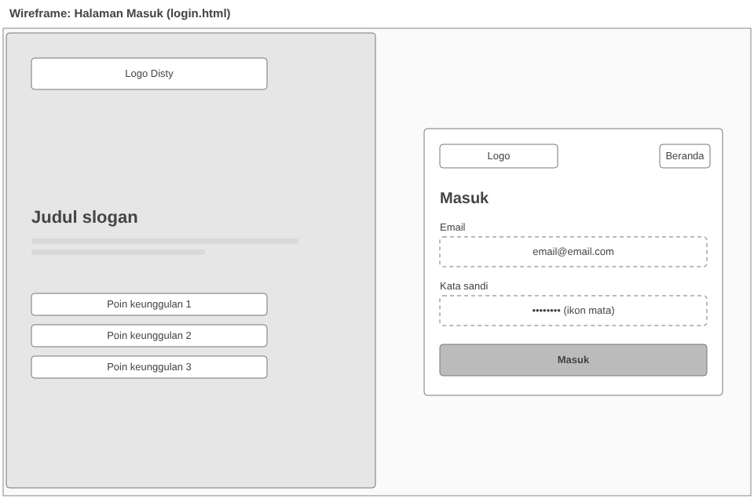
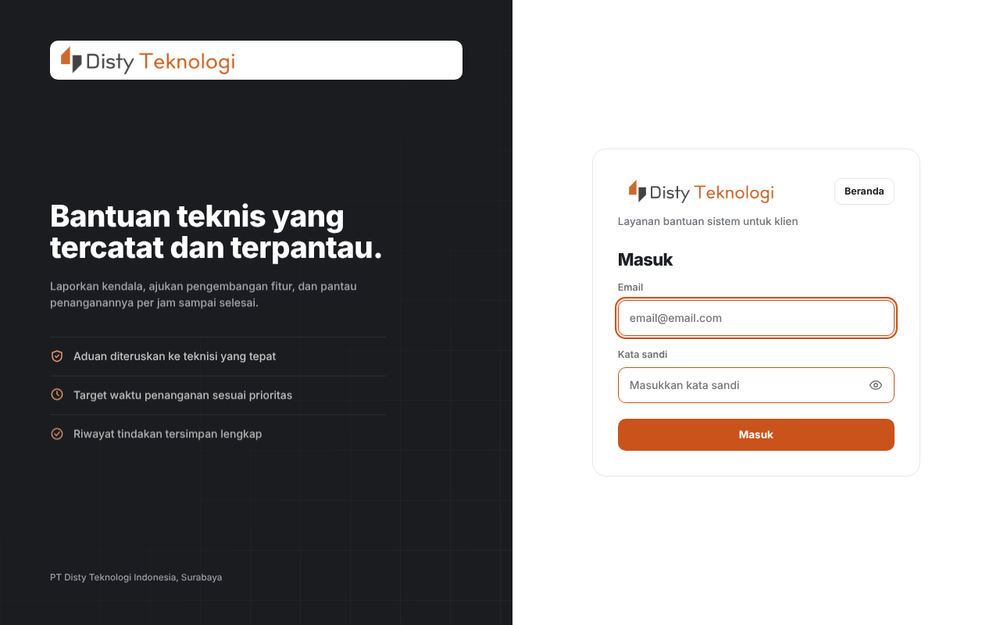
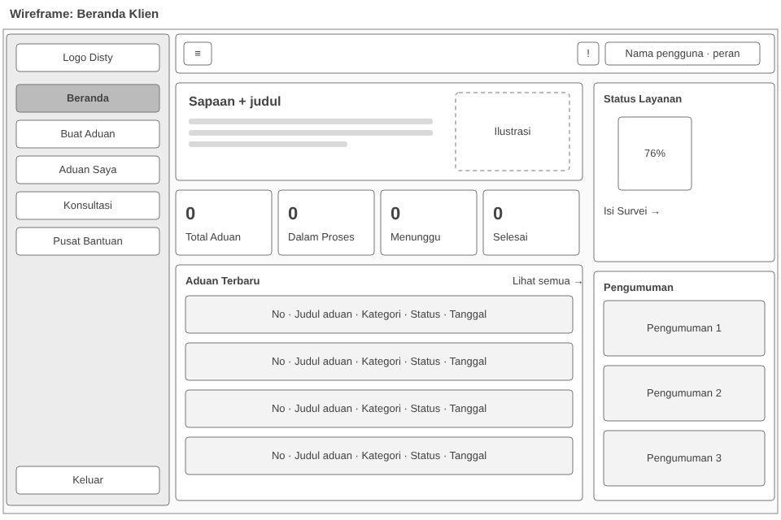
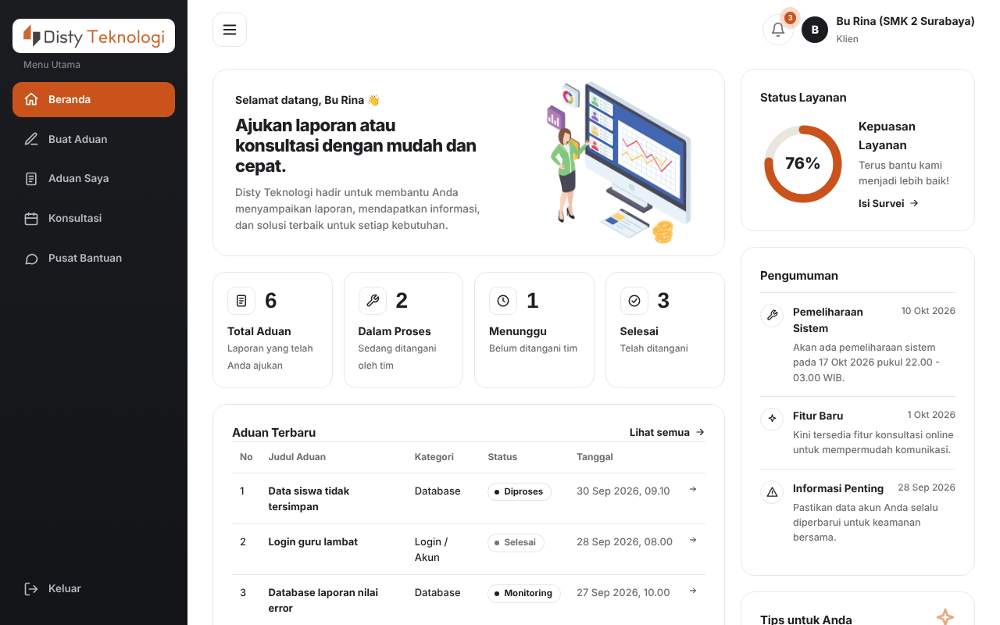
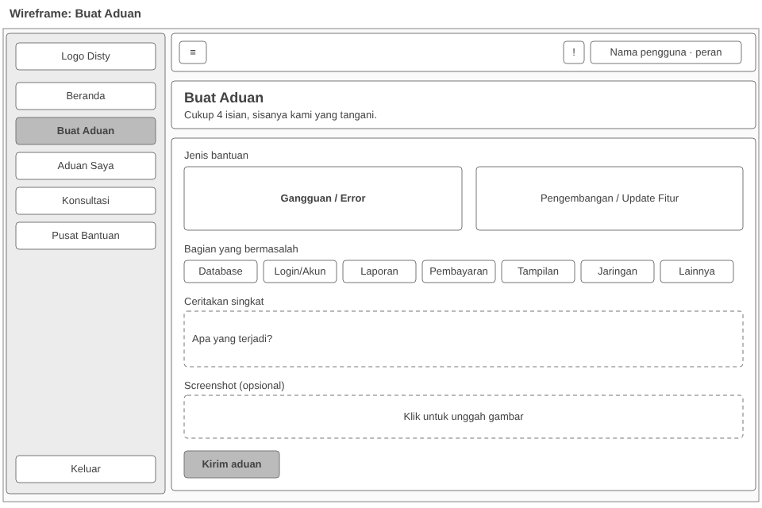
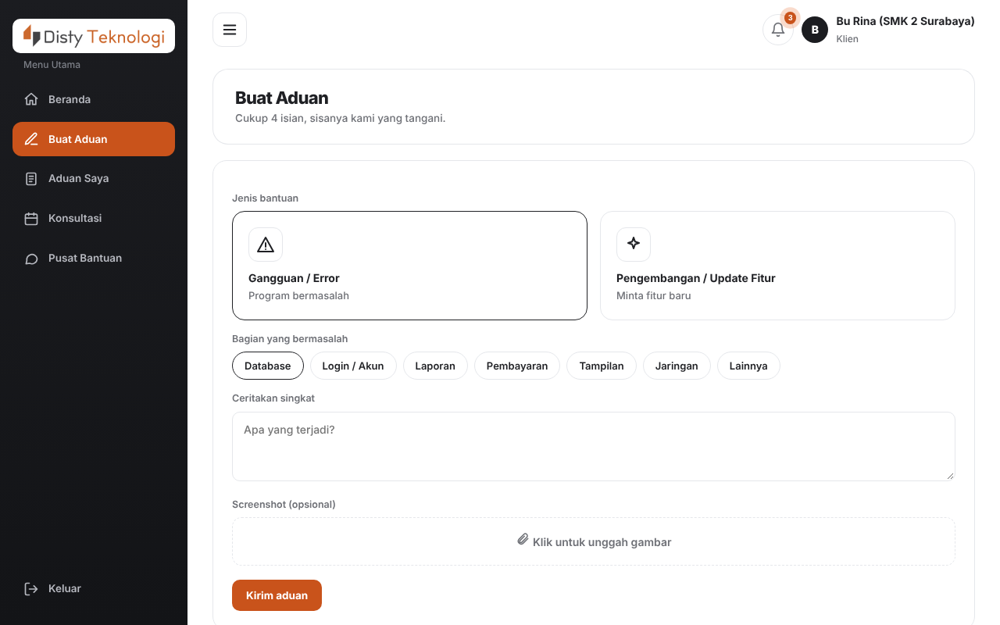
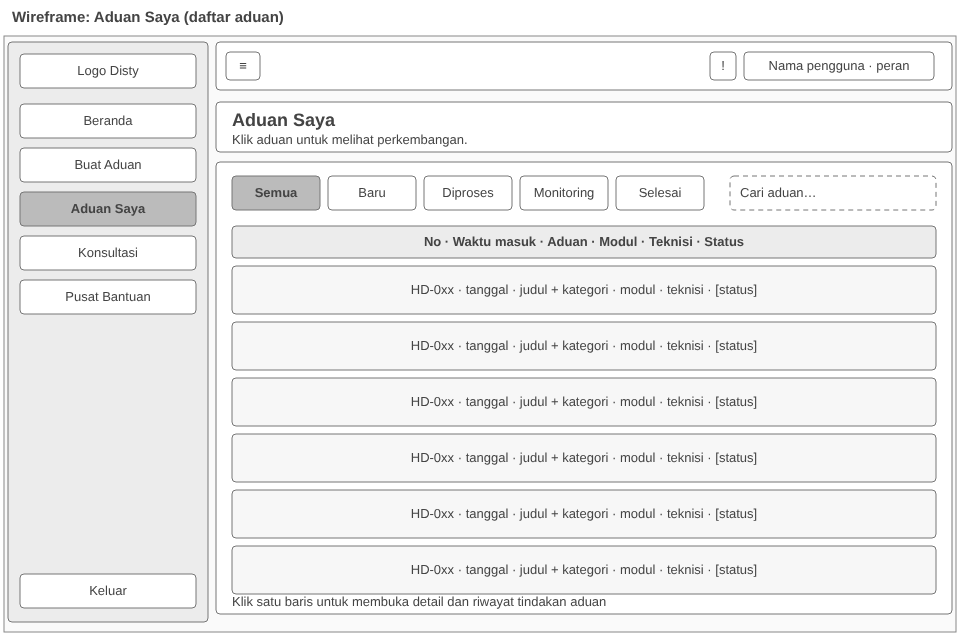
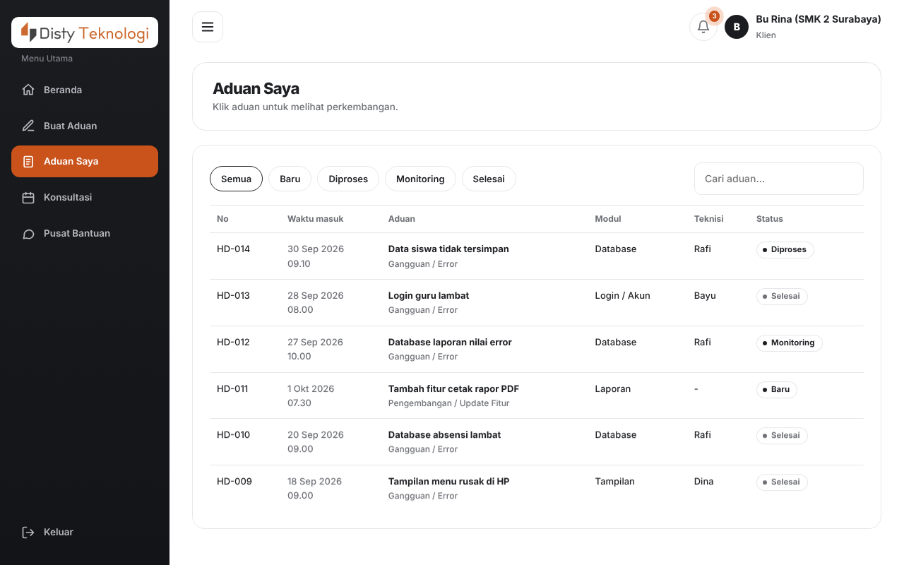
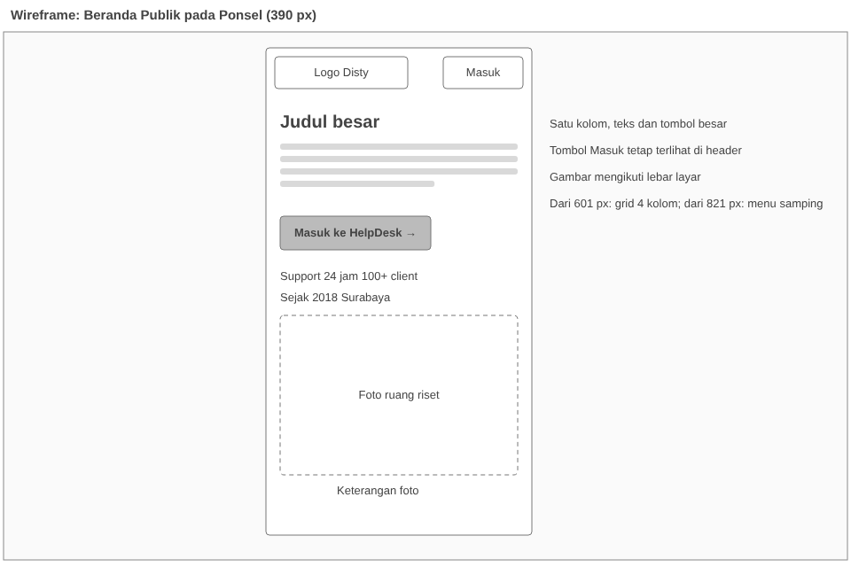
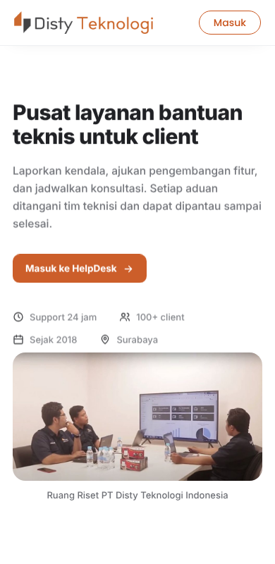

# UI/UX Design — Disty HelpDesk

Dokumen ini mencakup tiga butir silabus Modul 7: wireframe, prototyping, dan user testing.

## 1. Pengguna dan tujuan

| Peran | Tujuan utama | Layar utama |
|---|---|---|
| Klien (guru, staf instansi) | Melaporkan kendala atau meminta fitur, memantau perkembangannya, berkonsultasi | Beranda, Buat Aduan, Aduan Saya, Konsultasi, Pusat Bantuan |
| Admin helpdesk | Menetapkan prioritas, menugaskan teknisi, mengatur kuota konsultasi | Dashboard admin, daftar aduan, teknisi, konsultasi |
| Teknisi | Menangani aduan, mencatat tindakan dan solusi | Aduan ditugaskan, detail aduan, riwayat solusi |

## 2. Prinsip rancangan

- **Sedikit isian.** Formulir Buat Aduan hanya meminta jenis bantuan, bagian yang bermasalah, cerita singkat, dan screenshot opsional ("Cukup 4 isian, sisanya kami yang tangani").
- **Status selalu terlihat.** Setiap aduan memakai label status berwarna (Baru, Diproses, Monitoring, Selesai) dan riwayat tindakan berurutan waktu.
- **Satu pola navigasi.** Menu samping yang sama untuk semua peran, isinya menyesuaikan peran.
- **Mobile-first.** Gaya dasar dibuat untuk ponsel, lalu diperluas pada lebar 481 px ke atas.
- **Tema terang dan gelap** mengikuti pengaturan sistem atau pilihan pengguna.

## 3. Wireframe

Wireframe fidelitas rendah (abu-abu, tanpa warna merek) untuk lima layar. Berkas SVG dapat dibuka dan diedit.

| Layar | Wireframe | Hasil akhir |
|---|---|---|
| Masuk |  |  |
| Beranda klien |  |  |
| Buat aduan |  |  |
| Aduan saya |  |  |
| Ponsel (390 px) |  |  |

## 4. Prototyping

Prototipe interaktif adalah aplikasi itu sendiri dalam **mode tiruan**: `js/mock-api.js` menjawab semua permintaan API di dalam peramban, sehingga seluruh alur dapat diklik tanpa backend (login tiga peran, buat aduan, penugasan, penyelesaian, konsultasi, survei). Ini memungkinkan alur diuji dengan calon pengguna sebelum backend selesai. Latensi dan kegagalan jaringan dapat disimulasikan lewat `API_CONFIG.mock` di `js/api.js` (`latensiMs`, `peluangGagal`, `offline`).

Alur utama yang dibuat prototipenya:

1. Klien: Masuk → Buat Aduan → Kirim → Aduan Saya → buka detail.
2. Admin: Masuk → daftar aduan → tetapkan prioritas → tugaskan teknisi.
3. Teknisi: Masuk → buka aduan → catat tindakan → selesaikan dengan solusi.
4. Klien: lihat solusi → beri nilai.

## 5. User testing

### Rencana

- **Peserta:** 3 sampai 5 orang yang mewakili klien (guru atau staf), dan 1 orang untuk peran admin atau teknisi.
- **Cara:** tiap peserta diberi tugas tanpa petunjuk, diamati, lalu diwawancarai singkat. Waktu dan jumlah salah klik dicatat.
- **Perangkat:** satu laptop dan satu ponsel.

### Tugas uji

| No | Tugas | Keberhasilan |
|---|---|---|
| T1 | Masuk sebagai klien | Masuk dalam 30 detik tanpa bantuan |
| T2 | Buat aduan tentang "login guru lambat" | Aduan terkirim dalam 2 menit |
| T3 | Cari tahu status aduan tersebut | Menemukan status di Aduan Saya |
| T4 | Buat permintaan konsultasi | Permintaan terkirim |
| T5 | Ganti ke tema gelap | Tema berubah |
| T6 | (Admin) Tugaskan aduan ke teknisi | Penugasan tersimpan |

### Formulir pencatatan

| Peserta | Peran | Tugas | Berhasil (ya/tidak) | Waktu | Kendala yang terlihat | Saran |
|---|---|---|---|---|---|---|
| P1 | | | | | | |
| P2 | | | | | | |
| P3 | | | | | | |

### Pertanyaan wawancara

1. Bagian mana yang paling mudah dan paling membingungkan?
2. Apakah arti label status (Baru, Diproses, Monitoring, Selesai) jelas?
3. Apakah ada informasi yang Anda cari tetapi tidak ditemukan?
4. Seberapa nyaman tampilan di ponsel (skala 1 sampai 5)?

### Cara memakai hasil

Kendala yang muncul pada dua peserta atau lebih dikelompokkan, diberi prioritas, lalu diperbaiki pada iterasi berikutnya. Hasil pengujian dan perbaikannya dicatat pada tabel di atas.
